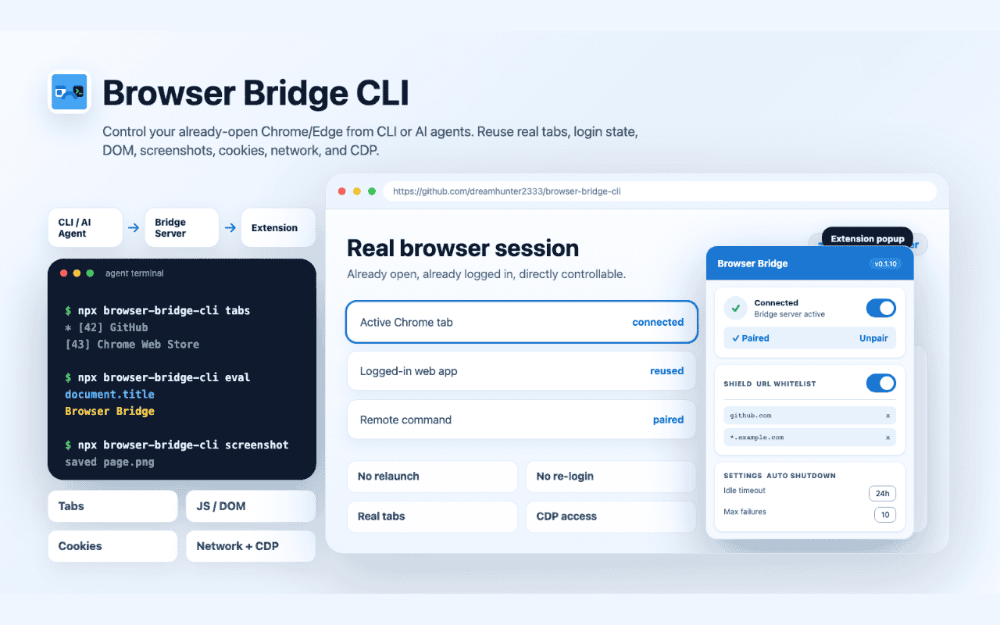

# Browser Bridge CLI

[English](README.md) | [中文](README_CN.md) · [Documentation](docs/README.md) · [Releases](https://github.com/dreamhunter2333/browser-bridge-cli/releases)

Control your already-open Chrome or Edge from a terminal or AI agent. Reuse existing tabs and login sessions through a paired extension, locally or across machines.

## Features

| Area | What you can do |
| --- | --- |
| Tabs & groups | List, inspect, open, activate, navigate, reload and close tabs; filter by window/group; create, rename, recolor, collapse, move and dissolve groups; move tabs between groups. |
| Mouse & keyboard | Click, double/right click, hover, move, scroll, insert text and send key codes/modifiers. A visible cursor shows automated input in screenshots and live shares. |
| DOM & JavaScript | Query CSS selectors, filter visible/in-viewport elements, evaluate expressions or local script files. |
| Capture & export | Viewport, full-page, clipped and stitched long screenshots; height caps and sticky-header handling; PDF export. |
| Network & cookies | Read/clear per-tab network logs and filter cookies by URL, domain or name. |
| Live remote control | Fixed-tab, follow-active-tab and selectable-tab links; click, drag, scroll, text and Chinese IME; persistent links. |
| Advanced browser operations | Upload files, drag/drop, read browser events and send native browser commands. |
| Multiple browsers | Pair multiple Chrome/Edge instances, list clients and choose the active browser. |
| Deployment & controls | Local or remote CLI/server/browser, one-time pairing, revocable tokens, site whitelist, idle shutdown and Linux systemd service. |

## Quick start

Requires Node.js 20+ or Bun 1.0+, and Chrome/Edge. Normal CLI usage supports macOS, Windows and Linux.

**1. Install the CLI and extension.**

```bash
npm install -g browser-bridge-cli
```

Install [Browser Bridge from the Chrome Web Store](https://chromewebstore.google.com/detail/browser-bridge/cmakbjpcmibhleibmgaiflpoencnelol), or load the ZIP from [GitHub Releases](https://github.com/dreamhunter2333/browser-bridge-cli/releases). Store review can lag behind releases; use a matching release extension for the latest features.

<details>
<summary>Load the extension manually / run without a global install</summary>

Download and unzip `browser-bridge-extension-v<version>.zip`. Open `chrome://extensions` or `edge://extensions`, enable **Developer mode**, choose **Load unpacked**, and select the extracted folder. From source, select `extension/`. Reload it after updating; tab groups require the `tabGroups` permission.

You can also replace `browser-bridge-cli` in the examples with `npx browser-bridge-cli` or `bunx browser-bridge-cli`.

</details>

**2. Start the local Bridge and pair.**

```bash
browser-bridge-cli server start
browser-bridge-cli server gen-pair
```

Open the extension popup, enable it, keep `ws://127.0.0.1:52853/ext`, enter the 6-digit code and click **Pair**. Each code is single-use and expires in 5 minutes.

**3. Find a tab and control it.**

```bash
browser-bridge-cli info
browser-bridge-cli tabs
browser-bridge-cli query 'button,a,input' --in-viewport -t 123
browser-bridge-cli screenshot -t 123 -o page.png
```

Replace `123` with a tab ID from `tabs`. Local commands read `~/.browser-bridge/` automatically. Use `browser-bridge-cli --help` or `<command> --help` for all flags.

## Guides

| Guide | Contents |
| --- | --- |
| [Commands](docs/commands.md) | Complete command map, tabs/groups, input, DOM, capture, network, CDP files/events. |
| [Live sharing](docs/tab-sharing.md) | Three viewer modes, remote input, authentication, capture lifecycle and streaming limits. |
| [Deployment & troubleshooting](docs/deployment.md) | Pairing, multiple browsers, config, two/three-machine setups, permissions and common errors. |
| [Privacy policy](PRIVACY.md) | Data flow, local storage, permissions and user control. |

<details>
<summary>Examples: tab groups, input and sharing</summary>

```bash
browser-bridge-cli tabs --json --group -1
browser-bridge-cli groups create 101 102 --title Work --color blue
browser-bridge-cli groups add-tabs 12 103
browser-bridge-cli groups update 12 --collapsed
browser-bridge-cli groups move 12 --window 2 --index -1
browser-bridge-cli groups delete 12                 # Keeps the tabs open

browser-bridge-cli click '#search' -t 123
browser-bridge-cli type 'hello' -t 123
browser-bridge-cli press Enter --key-code 13 -t 123
browser-bridge-cli scroll down 500 -t 123
browser-bridge-cli screenshot --long --max-height 12000 -t 123 -o long.png

browser-bridge-cli share start                     # Returns all three viewer links
browser-bridge-cli share links --tab 123
```

</details>

<details>
<summary>AI agent skills</summary>

Install the [browser control skill](skills/browser-bridge-cli/SKILL.md), the [website workflow skill generator](skills/browser-bridge-cli-skill-generator/SKILL.md), or both:

```bash
npx skills add dreamhunter2333/browser-bridge-cli/skills/browser-bridge-cli --agent claude-code codex
npx skills add dreamhunter2333/browser-bridge-cli/skills/browser-bridge-cli-skill-generator --agent claude-code codex
```

Choose one agent if needed; add `-g` for a global installation.

</details>

<details>
<summary>Product preview</summary>



</details>

Contributor documentation: [development and releases](docs/development.md).

MIT License.
